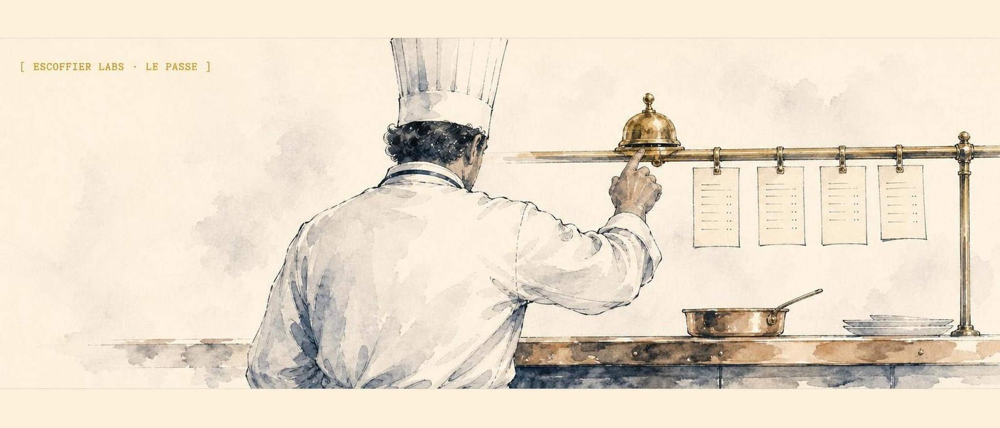

  

# Escoffier Labs

Mise en place for your agents.

We build open-source tools that give Claude Code, Codex, Cursor and your other agents one shared memory and one set of tools. The work ahead is orchestration: agents on different models sharing one codebase, passing work between them and checking each other's results.

Much of that work happens through [T3 Code](https://github.com/pingdotgg/t3code), which runs Claude, Codex and other agents side by side, on one machine or across several. With several sessions on different models touching the same repo, shared memory matters more: what one session learns, the next one should start with, whichever model it runs on.

## Flagship

- [BrigadeStack](https://brigadestack.com) ([source](https://github.com/escoffier-labs/brigade)) - shared memory, a shared task list and a record of every check, for Claude Code, Codex, Cursor, OpenCode and T3 Code. Evidence Memory, Memory Doctor and Code Intelligence ship inside it.

## Tools

- [Agent Pantry](https://github.com/escoffier-labs/agentpantry) - opt-in AES-256-GCM sync of the browser sessions and secrets you choose, from your daily machine to your agent hosts.
- [T3 Brigade Fleet](https://github.com/escoffier-labs/t3-brigade-fleet) - dispatches T3 Code sessions to allowlisted machines and tracks them until they finish, pause, or need recovery, with BrigadeStack receipts. Experimental.
- [Token Glace](https://github.com/escoffier-labs/token-glace) - deterministic compaction of terminal output before it reaches the agent. Installs as a BrigadeStack component with `brigade add tokens`. Forked from `vincentkoc/tokenjuice`.
- [Cloche](https://github.com/escoffier-labs/cloche) - desktop capture for people and agents, with stable JSON output and an optional MCP server.
- [Skillet](https://github.com/escoffier-labs/skillet) - agent skills for repo audits, bug hunting, security sweeps, publish gates, releases, and memory handoffs.
- [Bootstrap Doctor](https://github.com/escoffier-labs/bootstrap-doctor) - audits and trims oversize OpenClaw bootstrap files before sessions start truncated.
- [Code Search API](https://github.com/escoffier-labs/code-search-api) - local semantic code search with Ollama embeddings, SQLite, and hybrid search.
- [Usage Tracker](https://github.com/escoffier-labs/usage-tracker) - session analytics for OpenClaw, Claude Code, and Codex, separating API spend from subscription value.
- [Plating](https://github.com/escoffier-labs/plating) - reproducible, sanitized terminal-demo SVGs for READMEs and websites.
- [Solos Cookbook](https://github.com/escoffier-labs/solos-cookbook) - how one engineer runs a 24/7 multi-agent stack on bare metal.

## Start here

Install BrigadeStack with the [getting started guide](https://brigadestack.com/docs/getting-started/install), or see [escoffierlabs.dev](https://escoffierlabs.dev) for the rest of the lab.
