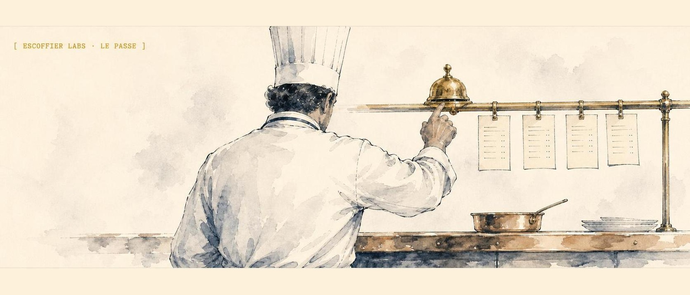

<p align="center">
  
</p>

# Escoffier Labs

Home of [Brigade](https://brigade.tools) and tools for running coding agents across harnesses and machines.

Brigade records which tasks are ready, who claimed them, what ran, and what the next session should know. It keeps MCP servers, skills, and memory in sync across local harnesses. The projects below cover code search, session analytics, bug capture, and the other tools around that work.

## Flagship

- [Brigade](https://github.com/escoffier-labs/brigade) - coordinates agent work across repositories, machines, and cloud seats, with local work records, verification receipts, and an optional fleet hub.

Code graphs, an evidence ledger, and agent notifications ship inside the Brigade monorepo and install via `brigade setup`. Publish-safety scanning is built in through `brigade scrub` and `brigade guard`.

## Skills & guides

- [Skillet](https://github.com/escoffier-labs/skillet) - agent skills suite: repo audits, bug hunting, security sweeps, publish gates, releases, and memory handoffs.
- [Solos Cookbook](https://github.com/escoffier-labs/solos-cookbook) - how one engineer runs a 24/7 multi-agent AI stack on bare metal.

## Agent ops

- [Agent Pantry](https://github.com/escoffier-labs/agentpantry) - secure browser session and secret sync for agent machines.
- [Memory Doctor](https://github.com/escoffier-labs/memory-doctor) - maintenance CLI for the Claude Code and OpenClaw memory systems.
- [Bootstrap Doctor](https://github.com/escoffier-labs/bootstrap-doctor) - audits and trims oversize OpenClaw prefix files into reference cards.
- [T3 Brigade Fleet](https://github.com/escoffier-labs/t3-brigade-fleet) - dispatches T3 Code sessions to allowlisted machines and tracks requests until they finish, pause, or need recovery, with Brigade receipts. Experimental.
- [Agent Notify](https://github.com/escoffier-labs/brigade/tree/main/stations/notify) - privacy-first push notifications for AI coding agents. Source lives at `stations/notify/` in Brigade and installs via `brigade setup`.
- [Cloche](https://github.com/escoffier-labs/cloche) - agent-neutral app screenshot capture.

## Dev tools

- [Brigade Code](https://github.com/escoffier-labs/brigade/tree/main/engines/code-graph) - local code-graph CLI and read-only MCP server: callers, callees, impact, and context. Source lives at `engines/code-graph/` in Brigade and installs via `brigade setup`.
- [Code Search API](https://github.com/escoffier-labs/code-search-api) - local semantic code search with Ollama embeddings, SQLite, and hybrid search.
- [Comeback](https://github.com/escoffier-labs/comeback) - turns screen recordings, voice, and annotations into bug-report bundles coding agents can read. Early Linux/X11 implementation.
- [Usage Tracker](https://github.com/escoffier-labs/usage-tracker) - local session analytics for OpenClaw, Claude Code, and Codex, separating API spend from OAuth subscription value in a static page.
- [Mise en Scene](https://github.com/escoffier-labs/mise-en-scene) - turns source material into self-contained interactive HTML/SVG technical explainers.
- [Plating](https://github.com/escoffier-labs/plating) - reproducible, sanitized terminal-demo SVGs for READMEs and websites.
- [Escoffier Fleet Kit](https://github.com/escoffier-labs/escoffier-fleet-kit) - shared theme, OG cards, and hands-off publishing for the Escoffier Labs website fleet.
- [Token Glace](https://github.com/escoffier-labs/token-glace) - deterministic output compaction that trims terminal noise before it hits agent context. Forked from `vincentkoc/tokenjuice`.

## Evidence stack

- [Brigade Evidence](https://github.com/escoffier-labs/brigade/tree/main/engines/evidence-ledger) - local evidence ledger for agent work history. Source lives at `engines/evidence-ledger/` in Brigade and installs via `brigade setup`.

## Archived repositories

These repositories are read-only. Development moved to the active home shown below.

| Repository | Current home |
|---|---|
| [Agent Notify](https://github.com/escoffier-labs/agent-notify) | [Brigade `stations/notify`](https://github.com/escoffier-labs/brigade/tree/main/stations/notify) |
| [Code Search MCP](https://github.com/escoffier-labs/code-search-mcp) | [Code Search API `mcp/`](https://github.com/escoffier-labs/code-search-api/tree/main/mcp) |
| [Content Guard](https://github.com/escoffier-labs/content-guard) | [Brigade `guard` and `scrub`](https://github.com/escoffier-labs/brigade) |
| [`graphtrail`](https://github.com/escoffier-labs/graphtrail) | [Brigade `engines/code-graph`](https://github.com/escoffier-labs/brigade/tree/main/engines/code-graph) |
| [`miseledger`](https://github.com/escoffier-labs/miseledger) | [Brigade `engines/evidence-ledger`](https://github.com/escoffier-labs/brigade/tree/main/engines/evidence-ledger) |
| [SourceHarvest](https://github.com/escoffier-labs/sourceharvest) | Absorbed into Brigade's evidence ledger in v0.3.0 |
| [`stationtrail`](https://github.com/escoffier-labs/stationtrail) | Absorbed into Brigade's evidence ledger in v0.3.0 |

## Start here

```sh
pipx install brigade-cli
brigade setup
```

Read the [Brigade docs](https://brigade.tools/docs), then use the supporting stations as your workflow needs them.
